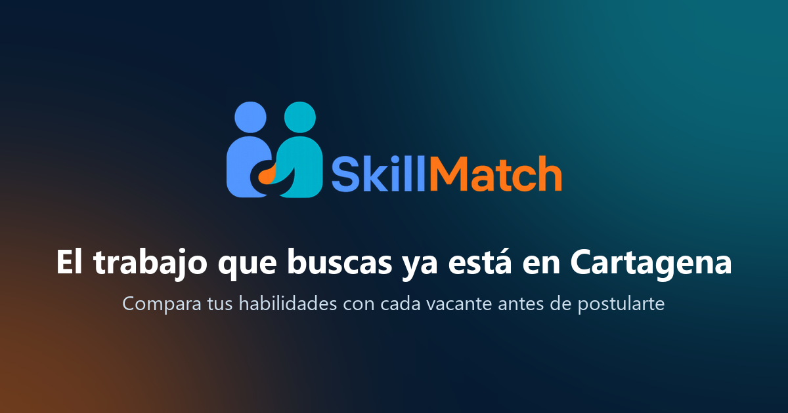
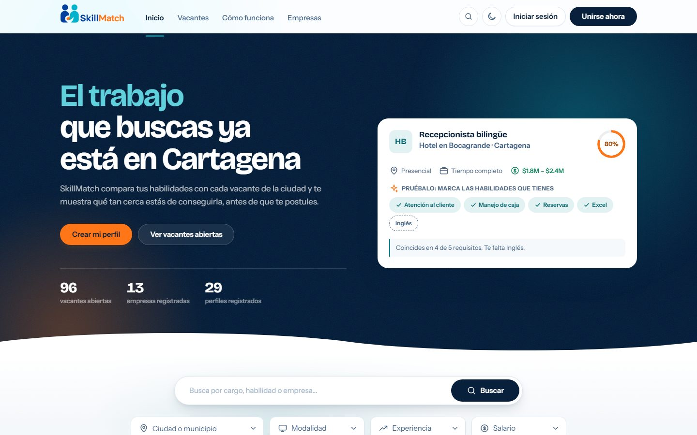
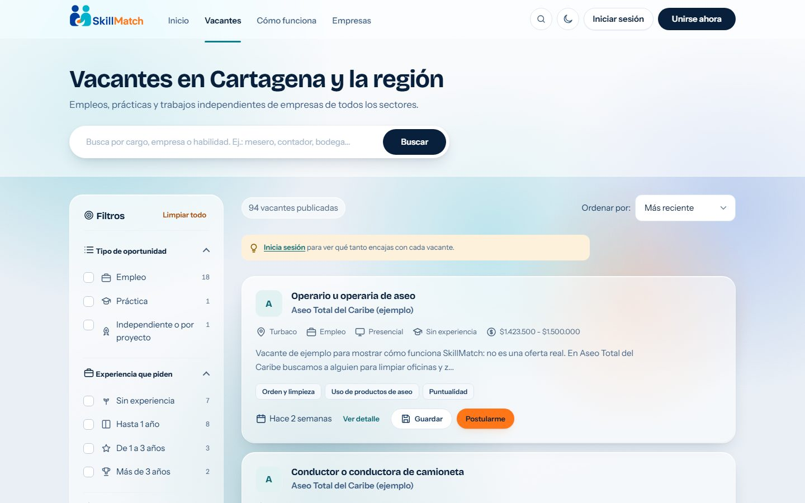
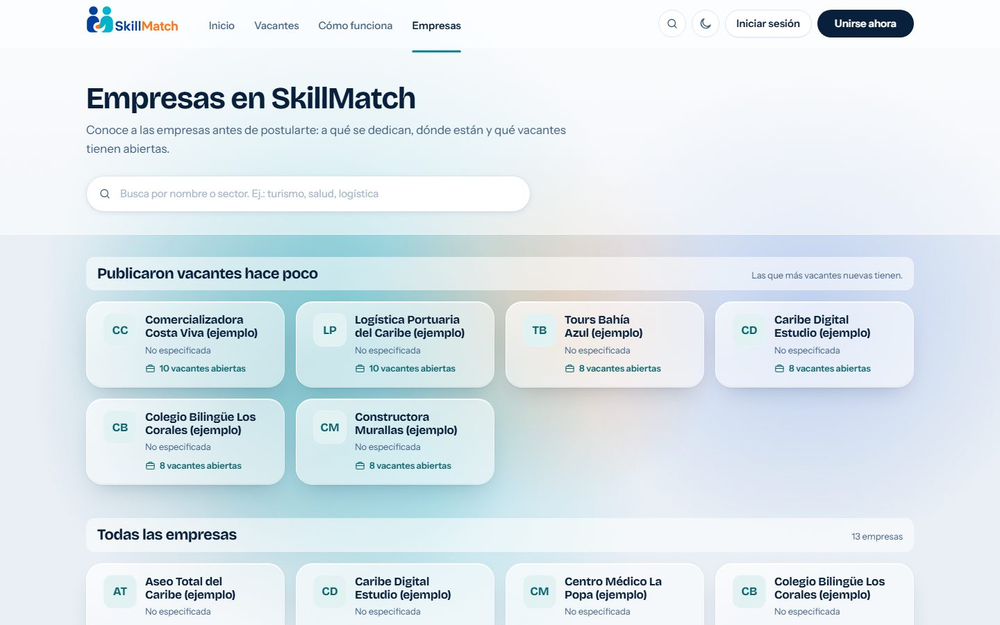
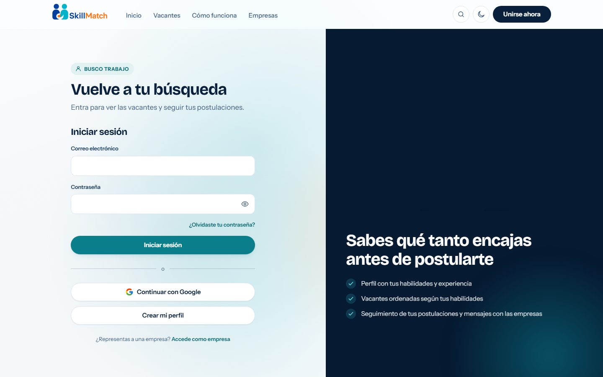
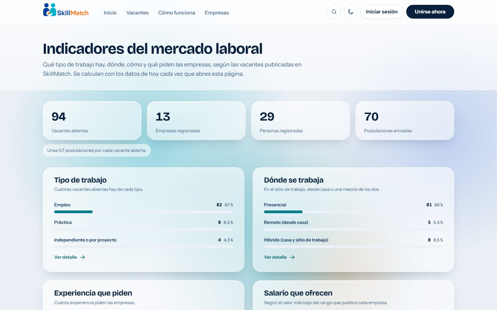
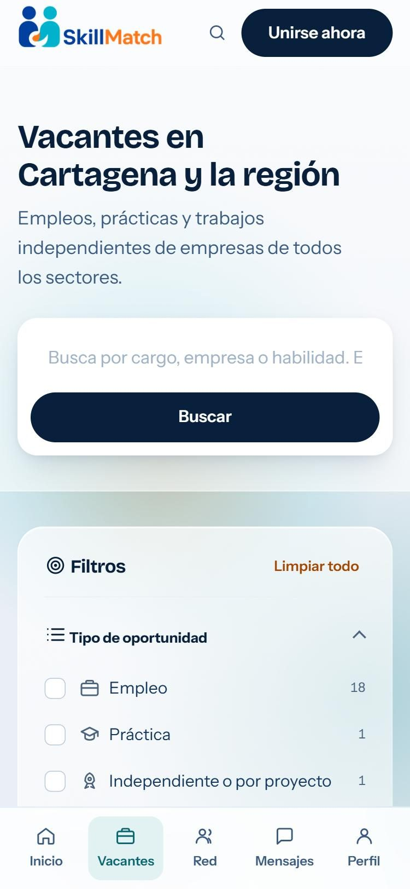
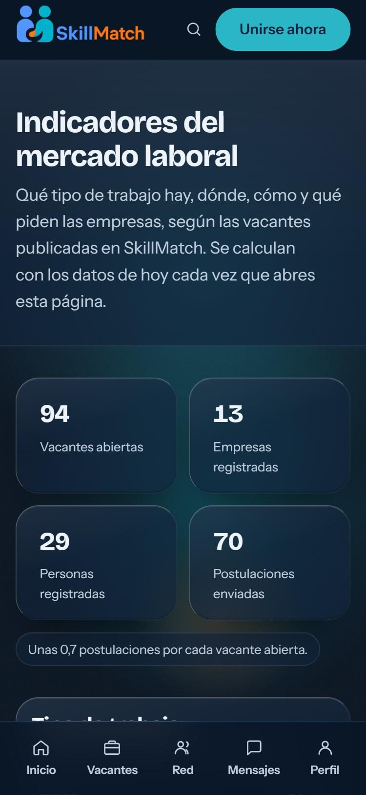
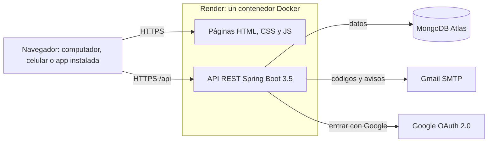

<div align="center">

<a href="https://skillmatch-yz37.onrender.com">
  
</a>

<h3>La bolsa de empleo de Cartagena que te dice qué tanto encajas en cada vacante <em>antes</em> de postularte.</h3>

<p>
  <a href="https://skillmatch-yz37.onrender.com"></a>
  <a href="#-empezar-en-local"></a>
  <a href="#-documentación"></a>
</p>

<p>
  
  
  
  
  
  
  
</p>

</div>

---

## Contenido

- [Qué es SkillMatch](#-qué-es-skillmatch)
- [Lo que puedes hacer](#-lo-que-puedes-hacer)
- [Cómo se ve](#-cómo-se-ve)
- [Cómo funciona por dentro](#-cómo-funciona-por-dentro)
- [Seguridad y datos personales](#-seguridad-y-datos-personales)
- [Empezar en local](#-empezar-en-local)
- [Pruebas](#-pruebas)
- [Despliegue](#-despliegue)
- [Estructura del repositorio](#-estructura-del-repositorio)
- [Documentación](#-documentación)
- [Minería de Datos I](#-minería-de-datos-i)
- [Cómo trabajamos](#-cómo-trabajamos)
- [Historia del proyecto](#-historia-del-proyecto)
- [Equipo](#-equipo)

---

## 🎯 Qué es SkillMatch

Buscar trabajo suele ser postularse a ciegas: mandas la hoja de vida y no sabes si de verdad encajas.
**SkillMatch** compara las habilidades de tu perfil con las que pide cada vacante de Cartagena y la región, y te
muestra **qué porcentaje cumples, qué te falta y por qué**, antes de que te postules.

Las empresas, del otro lado, publican sus vacantes, revisan a las personas que se postulan y conversan con ellas sin
salir de la plataforma.

<table>
<tr>
<td width="33%" valign="top">

**🔍 Para quien busca trabajo**<br>
Perfil con habilidades, experiencia y estudios; vacantes ordenadas según lo que sabes hacer y el seguimiento de cada
postulación.

</td>
<td width="33%" valign="top">

**🏢 Para las empresas**<br>
Publicar vacantes, revisar candidatos en un tablero, descargar las postulaciones en Excel y escribirles a las
personas.

</td>
<td width="33%" valign="top">

**📊 Para la ciudad**<br>
Indicadores públicos del mercado laboral: qué tipo de trabajo hay, dónde, con qué salario y qué piden las empresas.

</td>
</tr>
</table>

---

## ✨ Lo que puedes hacer

<details open>
<summary><b>Si buscas trabajo</b></summary>

- **El match:** cada vacante muestra tu porcentaje de compatibilidad y el botón *"¿Por qué este match?"* explica qué
  habilidades cumples y cuáles te faltan.
- **Vacantes cerca de ti:** con tu permiso, las más cercanas primero (sin guardar tu ubicación).
- **Búsqueda y filtros** por tipo de trabajo, modalidad, experiencia y salario, con la cuenta de cada filtro y todo
  guardado en la dirección para compartirlo.
- **Perfil completo:** habilidades con nivel, experiencia, estudios, foto y portada. Se puede **llenar desde tu hoja
  de vida en PDF** y **descargar como hoja de vida**.
- **Postularte con un mensaje propio**, guardar vacantes y ver en qué va cada postulación.
- **Red y mensajes:** conectar con otras personas y empresas, conversar, archivar y eliminar conversaciones.

</details>

<details>
<summary><b>Si representas a una empresa</b></summary>

- **Mi empresa:** primeros pasos guiados, logo y portada, y el perfil público que ven las personas.
- **Publicar y editar vacantes** con vista previa en vivo; cerrarlas y reabrirlas sabiendo qué pasa con quienes
  esperan respuesta.
- **Tablero de postulaciones** y ventana de candidatos para revisar a cada persona.
- **Descargar las postulaciones en Excel** (un `.xlsx` de verdad, con filtros y fechas como fechas).
- **Cifras de cada vacante** y mensajes directos con los candidatos.

</details>

<details>
<summary><b>Para todos</b></summary>

- **Entrar con Google** o con correo y contraseña; **"¿Olvidaste tu contraseña?"** con un código al correo.
- **Directorio de empresas** con su perfil público e **indicadores del mercado laboral** calculados con los datos del
  día.
- **Se instala como app** (PWA) y tiene una página para cuando no hay conexión.
- **Modo claro y oscuro**, tres tamaños de letra, navegación con teclado, respeto por *"reducir movimiento"* y
  *"reducir transparencia"*.
- **Paleta de comandos** con <kbd>Ctrl</kbd> + <kbd>K</kbd> para buscar vacantes y moverse por el sitio.
- **Recorrido guiado** la primera vez y avisos claros cuando el servidor se está despertando.

</details>

---

## 📸 Cómo se ve

> Las capturas cambian solas con el tema de GitHub: en modo oscuro ves el sitio oscuro y en modo claro, el claro.

<picture>
  <source media="(prefers-color-scheme: dark)" srcset="docs/img/portada-oscuro.jpg">
  
</picture>

<table>
<tr>
<td width="50%" align="center">
<picture>
  <source media="(prefers-color-scheme: dark)" srcset="docs/img/vacantes-oscuro.jpg">
  
</picture>
<br><sub><b>Vacantes</b>: filtros con su cuenta y el match de cada una</sub>
</td>
<td width="50%" align="center">
<picture>
  <source media="(prefers-color-scheme: dark)" srcset="docs/img/empresas-oscuro.jpg">
  
</picture>
<br><sub><b>Empresas</b>: el directorio y quién publicó hace poco</sub>
</td>
</tr>
<tr>
<td width="50%" align="center">
<picture>
  <source media="(prefers-color-scheme: dark)" srcset="docs/img/login-oscuro.jpg">
  
</picture>
<br><sub><b>Entrar</b>: con correo, con Google o recuperando la contraseña</sub>
</td>
<td width="50%" align="center">
<picture>
  <source media="(prefers-color-scheme: dark)" srcset="docs/img/indicadores-oscuro.jpg">
  
</picture>
<br><sub><b>Indicadores</b>: el mercado laboral con los datos del día</sub>
</td>
</tr>
</table>

<p align="center">
  
  &nbsp;&nbsp;&nbsp;
  
  <br><sub>En el celular, con la barra de pestañas abajo</sub>
</p>

---

## 🧩 Cómo funciona por dentro

Un **solo servicio** en Render sirve las páginas y la API desde el mismo dominio. Así no hay problemas de CORS ni dos
despliegues que mantener sincronizados.



| Capa | Tecnología | Notas |
|---|---|---|
| **Frontend** | HTML, CSS y JavaScript **sin frameworks** | Sistema de diseño propio en `app.css` (tokens `--*`), capa de interfaz en `ui.js` (iconos SVG, avisos, esqueletos de carga). Librerías de terceros guardadas en `assets/js/vendor/`, nunca desde un CDN |
| **Backend** | Spring Boot 3.5, Java 17, Spring Security | API REST con JWT en cookie `httpOnly`, OAuth2 para Google, envío de correo por SMTP |
| **Base de datos** | MongoDB Atlas (Spring Data) | Índices y migraciones que corren solos al arrancar |
| **Despliegue** | Docker en Render | El `Dockerfile` mete el frontend dentro del `.jar`; cada push a `main` se publica solo |
| **Pruebas** | JUnit 5 + Mockito, Playwright | ~300 pruebas del backend y 19 grupos de pruebas del frontend en Edge, computador y celular |

---

## 🔐 Seguridad y datos personales

El backend pasó por una **auditoría completa en 11 fases** ([informe](docs/AUDITORIA-BACKEND.md)), probada contra
MongoDB con ataques reales. Algunas de las protecciones:

| Tema | Cómo se protege |
|---|---|
| **Sesiones** | JWT en cookie `httpOnly` y `Secure`, que se invalida de verdad al cerrar sesión o cambiar la contraseña |
| **Fuerza bruta** | Límite de intentos por IP y bloqueo por cuenta tras 5 contraseñas equivocadas |
| **Acceso a datos** | Cada persona solo ve y cambia lo suyo; el correo y el teléfono no son públicos |
| **Entradas** | Búsquedas literales, límites de tamaño, solo enlaces e imágenes seguras, errores sin detalles internos |
| **Navegador** | CSP estricta, CORS cerrado al propio dominio y cabeceras de seguridad |
| **Cuentas** | Correos con servidor real (no desechables), contraseñas comunes rechazadas, recuperación con código de un solo uso |
| **Ley 1581 de 2012** | Prueba de la autorización con versión y fecha, plazos de retención y borrado de cuentas inactivas, [política de datos](SkillMatch/src/pages/politica-datos.html) |
| **Operación** | [Manual de incidentes](docs/OPERACION.md), copias cifradas con prueba de restauración y rotación de secretos |

---

## 🚀 Empezar en local

**Necesitas:** Java 17 o superior ([Adoptium](https://adoptium.net)), MongoDB Community 7 u 8
([descarga](https://www.mongodb.com/try/download/community)) y VS Code con la extensión **Live Server**.
Maven no hace falta: el proyecto trae `mvnw`.

**1. Clonar**

```bash
git clone https://github.com/jesuscastilla-cloud/Skillmatch.git
cd Skillmatch
```

**2. Arrancar el backend.** El script define las variables de desarrollo (base local, clave JWT de prueba, Swagger
encendido y los correos escritos en la consola en lugar de enviarse):

```powershell
cd backend
.\start.ps1
```

En macOS o Linux: `./start.sh`. Listo cuando aparece `Started BackendApplication`.
Comprueba que responde en http://localhost:8080/api/health y mira el mapa de la API en
http://localhost:8080/swagger-ui.html.

> ¿La base está vacía? Pon `SEED_ENABLED` en `true` en `start.ps1` **una sola vez** para llenarla con datos de prueba.

**3. Abrir el frontend.** En VS Code, clic derecho sobre `SkillMatch/src/pages/index.html` → **Open with Live
Server**. La página detecta que está en tu equipo y usa sola la API de `http://localhost:8080/api`.

<details>
<summary><b>Variables de entorno</b> (las de producción van en Render, nunca en el código)</summary>

| Variable | Para qué | Obligatoria |
|---|---|---|
| `MONGODB_URI` | Conexión a MongoDB (Atlas en producción) | Sí |
| `JWT_SECRET` | Clave que firma las sesiones, mínimo 32 caracteres | Sí |
| `MAIL_HOST`, `MAIL_USERNAME`, `MAIL_PASSWORD`, `MAIL_FROM` | Enviar códigos y avisos (Gmail con contraseña de aplicación) | Para el correo |
| `GOOGLE_CLIENT_ID`, `GOOGLE_CLIENT_SECRET` | "Continuar con Google" | Para Google |
| `PRIVACIDAD_EXIGIR_CONSENTIMIENTO`, `PRIVACIDAD_VERSION_POLITICA` | Exigir la autorización de datos y su versión | Recomendadas |
| `REGISTRO_VERIFICAR_CORREO` | Confirmar el correo con un código antes de crear la cuenta | Opcional |
| `CORREO_MODO_PRUEBA`, `SMS_MODO_PRUEBA`, `SWAGGER_ENABLED` | Solo en local | **Nunca** en Render |

La lista completa, con explicaciones, está en [`application.properties`](backend/src/main/resources/application.properties)
y en [`.env.example`](.env.example).

</details>

---

## 🧪 Pruebas

**Backend** (JUnit 5 + Mockito):

```bash
cd backend
./mvnw test
```

> En Windows, si el nombre de usuario tiene espacios: `./mvnw test "-DargLine=-Djdk.net.unixdomain.tmpdir=C:/Temp/skillmatch-java"`.

**Frontend** (Playwright, en Edge, computador y celular; no necesita backend porque usa una API falsa):

```bash
cd pruebas
npm install
npm test
```

Qué prueba cada archivo y cómo agregar una prueba: [docs/PRUEBAS-FRONTEND.md](docs/PRUEBAS-FRONTEND.md).

---

## ☁️ Despliegue

Render despliega solo **cada push a `main`** con el `Dockerfile` de la raíz, que compila el backend y mete el
frontend dentro del mismo `.jar`. La guía paso a paso (MongoDB Atlas, clave JWT, Render y cómo comprobarlo) está en
[docs/DESPLIEGUE.md](docs/DESPLIEGUE.md), y cómo activar el correo y Google en
[docs/AUDITORIA-BACKEND.md](docs/AUDITORIA-BACKEND.md#estado-27-de-octubre-de-2026).

---

## 🗂️ Estructura del repositorio

```text
Skillmatch/
├── SkillMatch/src/            Frontend: lo que ve la persona
│   ├── pages/                 Una página HTML por pantalla
│   └── assets/
│       ├── css/app.css        Sistema de diseño (tokens, componentes, vidrio, modo oscuro)
│       ├── js/                Un módulo por pantalla + ui.js (capa de interfaz) y api-config.js
│       └── img/               Logo, favicon, portadas
├── backend/                   API REST en Spring Boot
│   ├── src/main/java/…        controller · service · repository · model · security · config
│   ├── src/test/              Pruebas JUnit
│   └── start.ps1 / start.sh   Arranque local con variables de desarrollo
├── pruebas/                   Pruebas del frontend con Playwright y una API falsa
├── scripts/                   Copia cifrada y restauración de MongoDB
├── mineria-datos/             Análisis de Minería de Datos I (notebook y resultados)
├── documentos/                Entregas académicas en PDF
├── docs/                      Toda la documentación (ver abajo) e imágenes del README
├── Dockerfile                 Imagen única: backend + frontend
└── render.yaml                Servicio de Render
```

---

## 📚 Documentación

| Documento | Para qué sirve |
|---|---|
| [DESPLIEGUE](docs/DESPLIEGUE.md) | Publicar el sitio desde cero (Atlas, JWT, Render) |
| [OPERACION](docs/OPERACION.md) | Incidentes, copias de seguridad, rotación de secretos y aviso de brechas |
| [AUDITORIA-BACKEND](docs/AUDITORIA-BACKEND.md) | La auditoría de seguridad y datos personales, fase por fase, y cómo activar cada función |
| [CAMBIOS-FRONTEND](docs/CAMBIOS-FRONTEND.md) | Lo que el backend ya tiene y el frontend todavía no usa (tareas F1 a F13) |
| [PLAN-UI](docs/PLAN-UI.md) | El plan de mejoras de la interfaz, por fases |
| [PLAN-PERFIL-GLASS](docs/PLAN-PERFIL-GLASS.md) | El plan del estilo de vidrio en todo el sitio |
| [GUIA-DE-LENGUAJE](docs/GUIA-DE-LENGUAJE.md) | Cómo escribir los textos del sitio: claro, para todo público |
| [REGISTRO-Y-MARCO-LEGAL](docs/REGISTRO-Y-MARCO-LEGAL.md) | Los registros frente a la ley colombiana |
| [PRUEBAS-FRONTEND](docs/PRUEBAS-FRONTEND.md) | Las pruebas con Playwright |
| [MINERIA-DATOS](docs/MINERIA-DATOS.md) | El análisis de Minería de Datos I |
| [ANALISIS-FRONTEND](docs/ANALISIS-FRONTEND.md) · [ANALISIS-PROFUNDO](docs/ANALISIS-PROFUNDO.md) · [REVISION-CALIDAD](docs/REVISION-CALIDAD.md) · [AVANCE-VISUAL](docs/AVANCE-VISUAL.md) · [PENDIENTES-BACKEND](docs/PENDIENTES-BACKEND.md) | Revisiones y bitácoras del trabajo |
| [ENDPOINTS-API](docs/ENDPOINTS-API.md) · [GUIA-PRUEBAS-API](docs/GUIA-PRUEBAS-API.md) | La primera versión de la API (la referencia al día es Swagger) |

---

## 📈 Minería de Datos I

¿Las habilidades que pide una vacante permiten predecir su categoría laboral? Es la base del porcentaje de
compatibilidad. Con 1.167 vacantes y regresión logística, el modelo acierta el **73 %** en el conjunto de prueba
(contra 20,5 % de la referencia), y en validación cruzada Random Forest llega al **78,9 %**.

Análisis completo, datos, resultados y limitaciones: [docs/MINERIA-DATOS.md](docs/MINERIA-DATOS.md).
Entregas: [propuesta del modelo](documentos/propuesta_modelo.pdf) · [informe metodológico](documentos/informe_metodologico.pdf).

---

## 🤝 Cómo trabajamos

- **`main` es el sitio en vivo:** nunca se trabaja directo en ella. Todo cambio va en una rama y entra por un PR.
- **Ramas con prefijo** según lo que tocan:

  | Prefijo | Ejemplo |
  |---|---|
  | `frontend/` | `frontend/f11-recuperar` |
  | `backend/` | `backend/auditoria-seguridad` |
  | `docs/` | `docs/readme-presentacion` |
  | `fix/` | `fix/token-invalido` |

  Al fusionar el PR, la rama se borra.
- **Commits pequeños y en español**, con el área y lo que cambió (y, si no es obvio, por qué):

  ```text
  Sesión: un token que ya no vale no bloquea el sitio; se ignora y se borra la cookie
  F11: ¿Olvidaste tu contraseña? con código por correo
  ```

- **Antes de cada commit:** compila el backend (`./mvnw -q -DskipTests package`), `node --check` en cada JS
  modificado y ninguna página con etiquetas sin cerrar.
- **Nunca se suben secretos** (`MONGODB_URI`, `JWT_SECRET`, contraseñas): van en las variables de Render.

---

## 🕰️ Historia del proyecto

| Fecha | Hito |
|---|---|
| Sep 2026 | Primera versión desplegada: backend Spring Boot + MongoDB y la interfaz nueva |
| Sep 2026 | Identidad de marca: naranja del logo como acento, modo oscuro y plan de la interfaz |
| Oct 2026 | Fase visual ([#1](https://github.com/jesuscastilla-cloud/Skillmatch/pull/1)–[#10](https://github.com/jesuscastilla-cloud/Skillmatch/pull/10)): portada con el match en vivo, vacantes en baraja, mensajes, red, Mi empresa, PWA, indicadores propios, hoja de vida en PDF y pruebas con Playwright |
| Oct 2026 | Estilo de vidrio (*Liquid Glass*) en todo el sitio y "Vacantes cerca de ti" |
| Oct 2026 | Análisis de Minería de Datos I |
| Oct 2026 | Auditoría de seguridad y datos personales del backend en 11 fases ([#12](https://github.com/jesuscastilla-cloud/Skillmatch/pull/12)) |
| Oct 2026 | Entrar con Google ([#13](https://github.com/jesuscastilla-cloud/Skillmatch/pull/13)), correo con Gmail y "¿Olvidaste tu contraseña?" ([#15](https://github.com/jesuscastilla-cloud/Skillmatch/pull/15)) |

---

## 👥 Equipo

| | |
|---|---|
| **Jesús Castilla** | Backend, seguridad y despliegue |
| **Luis Amaya** | Frontend, diseño de la interfaz y pruebas |
| **Willer Rivero Marriaga** | Análisis de datos |
| **Luis Reyes** | Documentación |
| **Andrés** | Equipo del proyecto |

<div align="center">
<br>
<sub>Hecho en Cartagena de Indias para conectar a las personas con las empresas de la ciudad.</sub><br>
<sub>Proyecto académico. Sin licencia de código abierto por ahora: pregunta al equipo antes de reutilizar el código.</sub>
</div>
