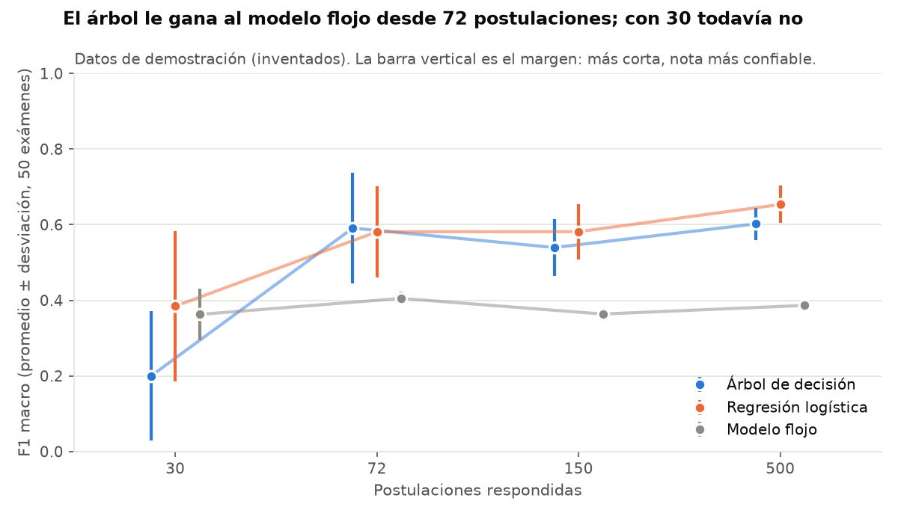

# SkillMatch - Minería de Datos I: clasificación de vacantes por habilidades

## El problema
SkillMatch conecta a estudiantes y aprendices con empresas de Cartagena según sus habilidades.
Antes de confiar en un emparejamiento por habilidades hay que comprobar con datos una pregunta:
**¿las habilidades que pide una vacante permiten saber de qué área es?**

Para responderla se entrena un modelo que recibe las habilidades de una vacante (`job_skill_set`)
y predice su categoría (`category`), que tiene 5 opciones: BUSINESS-DEVELOPMENT (desarrollo de
negocios), FINANCE (finanzas), HR (talento humano), INFORMATION-TECHNOLOGY (tecnología) y SALES (ventas).

Integrantes: Willer Rivero Marriaga, Luis Amaya Vidal, Jesús Castilla Orozco, Andrés Diaz Arnedo
(miembro externo) y Luis Reyes Simarra.

## Por qué es un problema de clasificación
| Tipo de minería | Qué hace | ¿Sirve aquí? |
|---|---|---|
| **Clasificación** | Predice una etiqueta que ya se conoce en los datos de entrenamiento | **Sí.** Cada vacante trae su categoría (5 opciones) y queremos predecirla |
| Regresión | Predice un número (por ejemplo, un salario) | No. El conjunto no trae ninguna columna numérica que predecir |
| Agrupamiento (*clustering*) | Forma grupos cuando no hay etiquetas | No para esta pregunta. Las etiquetas ya existen; agrupar no dice "esta vacante es de finanzas". Sí se usa aparte, como técnica descriptiva (ver más abajo) |
| Detección de anomalías | Busca casos raros o sospechosos | No. El objetivo no es encontrar vacantes extrañas |

Como se aprende a partir de ejemplos que ya tienen la respuesta, es **clasificación supervisada
multiclase** (más de dos clases).

## Los datos
- Archivo: `all_job_post.csv`, 1.167 vacantes en inglés, 5 columnas (`job_id`, `category`,
  `job_title`, `job_description`, `job_skill_set`).
- Fuente: Kaggle, conjunto "job-skill-set" de Batuhan Mutlu (2024):
  https://www.kaggle.com/datasets/batuhanmutlu/job-skill-set
- Origen: "LinkedIn Job Postings" de Arshkon (licencia CC BY-SA 4.0):
  https://www.kaggle.com/datasets/arshkon/linkedin-job-postings
- El CSV **no se sube al repositorio**. Se descarga de Kaggle (cuenta gratuita).
- Limitaciones: las vacantes están en inglés, vienen de LinkedIn y no traen ubicación, así que no
  representan necesariamente a Cartagena.
- Conjunto descartado: job_market_skills_dataset (Adzuna,
  https://www.kaggle.com/datasets/sharmagayatri/job-market-skills-dataset). Ninguna de sus 1.000
  filas trae salario, 925 son de una sola categoría y casi todas son de India.

## Cómo se preparan los datos (lo hace `comparar_modelos.py`)
1. El texto `"['Communication', 'Excel', 'excel']"` se convierte en una lista real, en minúsculas y
   sin repetidos: `['communication', 'excel']`.
2. Se separan 933 vacantes para entrenar y 234 para probar (80/20), manteniendo la misma
   proporción de cada categoría y con semilla 42. Esto se hace **antes** de construir las
   variables, para que las vacantes de prueba no influyan en el modelo.
3. Se conservan solo las habilidades que aparecen en al menos 10 vacantes del entrenamiento:
   quedan **198**.
4. Cada habilidad se vuelve una columna de 0 y 1 (1 si la vacante la pide), con `MultiLabelBinarizer`.

## Comparación de modelos
Validación cruzada de 5 pliegues (`StratifiedKFold`, semilla 42) sobre las 933 vacantes de
entrenamiento, y prueba sobre las 234 vacantes que ningún modelo vio.
Archivo: [`resultados/comparacion_modelos.csv`](resultados/comparacion_modelos.csv).

| Modelo | Familia | Exactitud CV (media ± desv.) | Exactitud en prueba | F1 macro en prueba |
|---|---|---|---|---|
| Referencia (siempre la clase más frecuente) | ninguna | 0,2047 ± 0,0020 | 0,2051 | 0,0681 |
| **Regresión logística** (modelo principal) | lineal | 0,7728 ± 0,0271 | **0,7308** | **0,7346** |
| Naive Bayes (Bernoulli) | probabilística | 0,7792 ± 0,0187 | 0,7650 | 0,7687 |
| Árbol de decisión (profundidad 5) | árboles | 0,5402 ± 0,0191 | 0,5598 | 0,5703 |
| Árbol de decisión (sin límite) | árboles | 0,6688 ± 0,0459 | 0,7094 | 0,7134 |
| Random Forest (200 árboles) | conjunto de árboles | 0,7888 ± 0,0256 | 0,7778 | 0,7820 |
| KNN (k = 7, distancia de Jaccard) | vecinos cercanos | 0,7106 ± 0,0155 | 0,6880 | 0,6936 |

Cómo leer la tabla:
- **Exactitud**: de cada 100 vacantes, cuántas clasifica bien. **F1 macro**: promedio del F1 de las
  5 categorías; baja si el modelo falla mucho en alguna, aunque acierte en las demás.
- Todos los modelos superan con mucho a la referencia (20,5 %), incluso el árbol más simple (54 %).
  Eso confirma que las habilidades sí revelan el área de la vacante.
- Random Forest, Naive Bayes y regresión logística quedan muy cerca (77 % a 79 % en validación
  cruzada). La diferencia entre el mejor y la regresión logística (1,6 puntos) es menor que la
  variación normal entre pliegues (2,7 puntos).
- Se mantiene la **regresión logística como modelo principal** porque es la más fácil de explicar:
  sus coeficientes dicen qué habilidades empujan hacia cada categoría, y eso es lo que SkillMatch
  necesita para justificar sus recomendaciones.

### Por qué un solo árbol predice peor que Random Forest
1. **Un árbol pequeño se queda corto.** Cada pregunta del árbol mira una sola habilidad ("¿pide
   *sales*?"). Con profundidad 5 hace como máximo 5 preguntas por vacante, pero una vacante pide
   unas 18 habilidades y la información está repartida entre muchas habilidades poco frecuentes.
   Por eso solo acierta 54 %.
2. **Un árbol sin límite se aprende de memoria el entrenamiento.** Sigue haciendo preguntas hasta
   separar casi cada vacante, incluido el ruido. Acierta 67 % y es el modelo más inestable
   (desviación de 4,6 puntos): si cambian un poco los datos, cambia mucho el árbol.
3. **Random Forest combina 200 árboles distintos.** Cada uno se entrena con una muestra al azar de
   vacantes y, en cada pregunta, con un grupo al azar de habilidades; al final votan. Los errores
   de unos árboles se compensan con los aciertos de otros, y en conjunto aprovechan muchas más
   habilidades. Por eso es el más preciso (78,9 %).

### Reglas de un árbol de profundidad 4
[`resultados/reglas_arbol.txt`](resultados/reglas_arbol.txt) muestra un árbol pequeño en forma de
reglas, por ejemplo: *si la vacante pide "employee relations" y no pide "internal controls",
entonces es de HR*; *si no pide "employee relations" ni "business development" pero sí
"financial analysis" y no "sales", entonces es de FINANCE*. Son fáciles de leer, pero ese árbol
solo acierta 54,7 % en prueba: sirve para explicar el modelo, no para reemplazarlo.

## Otras técnicas: reglas de asociación y agrupamiento
La clasificación es **predictiva** (aprende de vacantes que ya tienen categoría para predecir la de
una nueva). `patrones_asociacion_agrupamiento.py` agrega dos técnicas **descriptivas**, que buscan
patrones sin usar la categoría, sobre las mismas 1.167 vacantes y 198 habilidades
(`resultados/dataset_vacantes_preparado.csv`).

**Reglas de asociación (Apriori).** Buscan habilidades que aparecen juntas. Una regla
"A → B" se mide con tres números:
- *soporte*: en qué parte de todas las vacantes aparecen A y B juntas;
- *confianza*: de las vacantes que piden A, cuántas piden también B;
- *lift*: cuántas veces más aparece B junto a A de lo que se esperaría por azar (1 = sin relación).

Con soporte de al menos 4 %, confianza de al menos 50 % y lift de al menos 1,5 salen 51 reglas
([`resultados/reglas_asociacion.csv`](resultados/reglas_asociacion.csv)). Algunas:

| Regla | Soporte | Confianza | Lift | Categoría donde aparece |
|---|---|---|---|---|
| performance management → employee relations | 5,0 % | 69,9 % | 7,9 | HR (100 %) |
| budgeting → financial reporting | 4,1 % | 58,5 % | 7,2 | FINANCE (95,8 %) |
| financial reporting → financial analysis | 4,6 % | 56,8 % | 5,1 | FINANCE (98,1 %) |
| business development + problem solving → relationship building | 4,5 % | 52,0 % | 2,3 | BUSINESS-DEVELOPMENT (83,0 %) |
| customer service + relationship building → teamwork | 4,1 % | 75,0 % | 1,5 | SALES (66,7 %) |
| problem solving + project management → leadership | 8,5 % | 53,8 % | 1,9 | INFORMATION-TECHNOLOGY (33,3 %) |

Las reglas más fuertes (lift de 5 a 8) son de HR y FINANCE, que son también las categorías que el
modelo reconoce mejor. Las de ventas, desarrollo de negocios y tecnología son más débiles y se
reparten entre varias categorías.

**Agrupamiento (K-Means, 5 grupos).** Forma 5 grupos de vacantes según sus habilidades, sin ver la
categoría, y después se compara cada grupo con las categorías reales
([`resultados/agrupamiento_kmeans.csv`](resultados/agrupamiento_kmeans.csv)):

| Grupo | Vacantes | Categoría dominante | Habilidades que más lo distinguen |
|---|---|---|---|
| 1 | 123 | HR (99,2 %) | employee relations, performance management, interpersonal skills |
| 2 | 119 | FINANCE (95,0 %) | financial analysis, financial reporting, budgeting |
| 4 | 197 | BUSINESS-DEVELOPMENT (66,5 %) y SALES (31,5 %) | business development, sales, negotiation |
| 3 | 331 | mezcla (INFORMATION-TECHNOLOGY 41,1 %) | collaboration, project management, leadership |
| 0 | 397 | mezcla (SALES 34,5 %) | teamwork, customer service, attention to detail |

Sin conocer las etiquetas, K-Means separa casi perfecto a HR y FINANCE, junta desarrollo de
negocios con ventas en un mismo grupo (la misma confusión que tiene el clasificador) y deja 728
vacantes (62 %) en dos grupos mezclados que comparten habilidades generales. La silueta es baja
(0,045 con distancia de Jaccard; [`resultados/agrupamiento_silueta.csv`](resultados/agrupamiento_silueta.csv)):
los grupos se solapan, algo común cuando cada vacante tiene pocas habilidades de 198 posibles.
Se usan 5 grupos para compararlos con las 5 categorías.

## Relación con la aplicación
Campos reales del repositorio que conectan este análisis con SkillMatch:
- `skills` de cada vacante (`List<String>`, `backend/.../model/Job.java`): son las habilidades
  que un modelo como este leería.
- `skills` de cada persona (`List<Skill>` con `name`, `level` y `yearsOfExperience`,
  `backend/.../model/User.java`).
- El porcentaje de compatibilidad **no se guarda en la base de datos**: se calcula en el
  navegador (`getSkillMatch`, `SkillMatch/src/assets/js/oportunidades.js`) como habilidades de la
  vacante que la persona tiene ÷ habilidades que pide. Hoy todas las habilidades pesan igual; los
  coeficientes del modelo sirven para ponderarlas.
- La aplicación no tiene un campo de categoría de vacante. Lo más parecido es `industry` de la
  empresa (`Company.java`), con 12 sectores sugeridos en `perfil-empresa.js`.

## Cómo reproducirlo
1. Instalar las dependencias: `pip install -r requirements.txt`
2. Descargar `all_job_post.csv` de Kaggle y dejarlo en esta carpeta (`mineria-datos/`).
   No lo subas al repositorio.
3. Ejecutar:
   ```
   python comparar_modelos.py
   ```
   o, si el CSV está en otra carpeta:
   ```
   python comparar_modelos.py C:/ruta/a/all_job_post.csv
   ```
4. Debe decir `Habilidades usadas: 198` y terminar con tres líneas `OK` (exactitud 0,7308,
   F1 macro 0,7346 y referencia 0,2051, las mismas cifras del cuaderno de Colab).
5. Reglas de asociación y agrupamiento (no necesitan el CSV de Kaggle):
   ```
   python patrones_asociacion_agrupamiento.py
   ```

Notas de reproducibilidad: las cifras se obtuvieron con scikit-learn 1.9.1. Random Forest usa
200 árboles, como el cuaderno; con 100 árboles da 0,7835. KNN puede variar unas décimas con otra
versión de scikit-learn, porque con la distancia de Jaccard hay muchos empates entre vecinos.

## Prototipo: ¿será aceptada una postulación?
`prototipo_modelo_postulaciones.py` es el modelo predictivo que va a tener la app, hecho primero
en Python. Aprende de las postulaciones que las empresas ya aceptaron o rechazaron y le dice a cada
persona si sus posibilidades son buenas, regulares o bajas, y qué la ayudaría.

**Hoy usa datos de demostración**, inventados y marcados así en cada archivo y cada gráfica. Las
empresas todavía no han respondido suficientes postulaciones. Cuando SkillMatch exporte su CSV
anónimo, el mismo script lo lee:
```
python prototipo_modelo_postulaciones.py                          (demostración)
python prototipo_modelo_postulaciones.py postulaciones_anonimas.csv
```

Cómo funciona:
- **12 variables** de cada postulación, tomadas en el momento de postularse: % de habilidades
  pedidas, nivel, años de experiencia y si alcanzan, estudios, perfil completo, carta y su largo,
  ciudad, tipo de vacante, días hasta postularse y cuántos se habían postulado antes.
- **Tres modelos compiten**: árbol de decisión (con límites que crecen con los datos y pesos por
  clase), regresión logística y el modelo flojo (siempre «rechazada»).
- **El examen**: 5 partes (`StratifiedGroupKFold`, cada vacante entera en una sola parte),
  repetido 10 veces = 50 exámenes. La nota es el F1 macro promedio ± su desviación.
- **Reglas**: gana el árbol salvo que la regresión le saque más de 0,05. El modelo solo da
  posibilidades si le gana al modelo flojo por 0,05 o más (estado «Activo»).

Resultados con los datos de demostración
([`resultados/prototipo/resumen_por_tamano.csv`](resultados/prototipo/resumen_por_tamano.csv)):

| Postulaciones | Árbol (F1 macro) | Regresión logística | Modelo flojo | Estado | Gana |
|---|---|---|---|---|---|
| 30 | 0,20 ± 0,17 | 0,38 ± 0,20 | 0,36 ± 0,07 | Aprendiendo | — |
| 72 | 0,59 ± 0,15 | 0,58 ± 0,12 | 0,41 ± 0,02 | Activo | Árbol |
| 150 | 0,54 ± 0,07 | 0,58 ± 0,07 | 0,36 ± 0,02 | Activo | Árbol (la regresión gana por menos de 0,05) |
| 500 | 0,60 ± 0,04 | 0,65 ± 0,05 | 0,39 ± 0,00 | Activo | Regresión logística |



Lo que enseña el prototipo:
1. **Con 30 postulaciones de 5 vacantes no se puede.** El árbol saca menos que el modelo flojo y
   el sistema lo detecta solo: queda en «Aprendiendo» y no muestra posibilidades.
2. **El margen se achica con más datos**: ± 0,15 con 72 y ± 0,04 con 500. Por eso la nota se
   muestra siempre con su margen.
3. **Con pocos datos el árbol se confunde.** Con 72 usa «días hasta postularse», que en la regla
   escondida no influye. Con 500 encuentra justo las tres que sí pesan: habilidades (0,73),
   carta (0,14) y perfil completo (0,14)
   ([`importancia_variables.csv`](resultados/prototipo/importancia_variables.csv)).
4. **Mezclar vacantes en el examen engaña más cuando hay pocas.** Con 30 postulaciones el examen
   mezclado le sube 0,20 la nota al árbol; con 500, casi nada
   ([`examen_por_vacante_vs_mezclado.csv`](resultados/prototipo/examen_por_vacante_vs_mezclado.csv)).
5. **El recuadro de Valentina** (67 % de habilidades, carta de 40 palabras) dice «buenas» desde
   72 postulaciones
   ([`posibilidades_ejemplos.csv`](resultados/prototipo/posibilidades_ejemplos.csv)).

En `prototipo_arbol_150.png`, `value` es la proporción ya con los pesos por clase; el % real de
aceptadas de cada hoja está en `posibilidades_ejemplos.csv`.

## Contenido de esta carpeta
- `prototipo_modelo_postulaciones.py`: prototipo del modelo de postulaciones (datos de
  demostración o el CSV anónimo de SkillMatch). Resultados en `resultados/prototipo/`.
- `comparar_modelos.py`: comparación de 6 algoritmos y reglas del árbol.
- `patrones_asociacion_agrupamiento.py`: reglas de asociación (Apriori) y agrupamiento (K-Means).
- `SkillMatch_Clasificacion_Vacantes_por_Habilidades.ipynb`: cuaderno de Google Colab con el
  análisis completo de la regresión logística.
- `resultados/`: métricas, comparaciones, habilidades por categoría, dataset preparado, figuras y
  el reporte de MinedApp.
- Documentación general: [`../docs/MINERIA-DATOS.md`](../docs/MINERIA-DATOS.md).
